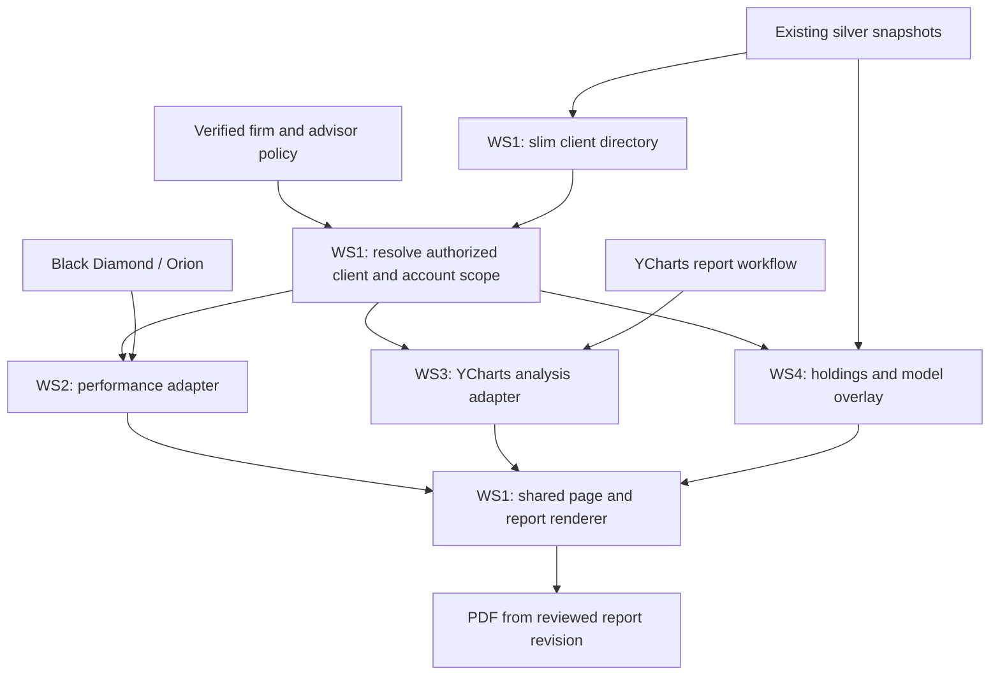

# Lightweight Investor Reporting — research and proposed design

**Author:** 4.0.0_SA_CRO (Chief Research Officer)  
**Home:** org/tier1_exec/4.0.0_SA_CRO/  
**Recon ID:** RCN-0008, downstream pilot design  
**Parent:** [L1 brief](investor-reporting-lightweight-brief-20260910.md)  
**Status:** PROPOSAL grounded in source inspection and prior captured evidence. This annex supports the brief; it is not a task-order decomposition or a claim of deployed behavior. Source IDs E01–E31 resolve in §7 and the fingerprint manifest.

**September 10 WS2 update:** the [performance presentation review](investor-reporting-performance-review-20260910.md) supersedes the original performance evidence gaps below where explicitly tested. Andrew supplied three HARs/four screenshots and authorized live exploration. BD period/series and Orion household/account calculations succeeded. Orion summary and breakdown returns use different units; daily vendor factors support the proposed cumulative chart, while a derived dollar-value series failed an independent valuation check. The review supplies the concrete common layout, mapping, source manifest and synthetic sketch. This does not change the other workstream evidence or constitute product/endpoint ratification.

## 1. Page and shared interaction contract — WS1

### 1.1 Proposed page layout

```text
INVESTOR REPORTING
Client search [ Search clients by name…                         ]
Selected client · relationship / selected accounts · firm · data as-of

       REPORTING              ANALYSIS                HOLDINGS
    Performance report    Sensitivity analysis     Models → securities

    Tab-specific controls and report content
    Reporting / Analysis: Export PDF for the reviewed report revision
```

Use existing `PageHeaderCleanBadge`, Panel/PanelHeader/PanelContent, `TabNavigation`, `useTabNavigation`, `PageSurfaceControl`, and the Catalyst combobox. The header is above the tabs; client selection is page-level state. The existing tab pattern distributes the labels evenly across the page. Reuse its visual treatment, then exercise keyboard navigation, focus order, tab/tabpanel semantics, screen-reader labels, narrow-screen layout and printing; the inspected component does not itself prove those behaviors.

The selected relationship defaults to all **authorized** underlying accounts. An account selector permits a narrower view. A result includes a display name and an account/relationship discriminator, with masked account details where necessary; duplicate names are not identifiers. Keep names and raw vendor identifiers out of navigation analytics. A client switch invalidates the old scope and clears old content synchronously; abort pending requests and also check the returned scope/revision before displaying results.

Proposed tab bodies:

| Tab | Leading content | Detail | Primary action |
|---|---|---|---|
| Reporting | Period and method-labelled performance summary | Value/return series, period results, provider-supplied benchmark and activity sections supported by the contract | Generate/refresh report, Export PDF |
| Analysis | Supported YCharts report variant and comparison selection | Opal presentation of that variant's returned sections, retaining its dates and methodology | Generate analysis, Export PDF |
| Holdings | Model allocation/assignment breakdown and unassigned residual | Model → account → security detail; actual holdings and target view kept distinct | Select model/account or expand securities |

Do not delay the header until a vendor answers. Fetch the active report tab after selection; request an inactive vendor report only on a defined user action or justified prefetch policy. Basic header values from silver carry their own snapshot date and are not labelled as the current performance report value.

### 1.2 Shared scope and response envelopes — proposed, not existing endpoints

Logical operations (final route names belong to implementation): `searchClients`, `resolveScope`, `requestPerformance`, `requestAnalysis`, `getHoldings`, `getReportStatus`, `exportReport`.

| Contract | Minimum content | Owner |
|---|---|---|
| `ClientDirectoryEntry` | Opaque stable client key; display name; firm; relationship/account membership keys; masked account labels; mapping capability per tab; directory revision; source dates | WS1 |
| `ResolvedScope` | Verified firm and viewer-policy reference; directory/entitlement revision; canonical relationship or account selection; deduplicated permitted account set; account-set fingerprint; explicit partial-scope state; namespaced vendor mappings retained server-side | WS1 |
| `ReportEnvelope` | Contract version; report ID/revision; scope fingerprint; requested/returned period; source/provider and tenant configuration reference; source-as-of and fetched/generated times; status; coverage; content; method/disclosure/template versions | WS1 common envelope; WS2/WS3 content |
| `HoldingsEnvelope` | Same scope identity; holdings date; model-map date(s); assignment provenance; actual positions; model groups; residuals; reconciliation and coverage | WS4 |

Server resolution is authoritative. Browser firmId/advisorId/account lists are selectors to validate, not trusted permissions. A scope token/reference must be bound to the authenticated principal and current permission version, not a bearer grant that outlives revocation. Recheck authorization when requesting a report, polling it and downloading it. A relationship-level vendor result is acceptable only when its account set matches the authorized selected set. Where the provider cannot produce that subset, return unsupported/partial scope; do not fetch a broad result and hide its rows after aggregate values have leaked.

## 2. Client discovery and silver-cache methodology — WS1

### 2.1 Build a small index from existing snapshots

Create a derived directory projection from completed identity/account/relationship/advisor snapshots. Store the useful subset—client labels, memberships, mapped IDs, entitlement tags, small summary fields—outside raw silver under the project's declared product namespace. Keep raw vendor/custodian identity facts in their existing source trees. A completed snapshot changes the directory revision; a user keystroke does not run a Parquet join or call a vendor.

Proposed simplest serving shape: a small authenticated directory service caches a firm projection in process, resolves the viewer's allowed account set, and returns only that viewer's search results and permitted member summaries. Reuse the combobox on a viewer-scoped result list. If measured directory size supports preloading a whole viewer-specific index, do so once per revision; otherwise serve bounded prefix queries against the cached projection. Do not download an entire firm directory to a restricted advisor and filter it in the browser.

Refresh from existing completion/version markers. Avoid a new scheduled whole-estate scan; where no trustworthy completion marker exists, declare and implement a bounded refresh path for that source. Cache immutable projections by input revision; keep authorization revision separate so permission changes can invalidate visibility without rebuilding all names. Set TTLs after measuring update cadence and revocation requirements, not by inventing constants in this brief.

### 2.2 Per-partner identity map

| Partner | Existing inspected substrate | Directory / vendor mapping proposal | Unresolved proof |
|---|---|---|---|
| **49 Financial** | `schwab/08335338/silver/fact_acc`, `fact_fam`; BD `blackdiamond/49f/silver/dim_advisor_fee_role` and `dim_account_xref`; SmartX `smartx/platform/silver/fact_allocation_account_map` | Keep Schwab padded account ID, BD native account ID, BD account-number fields, SmartX account/allocation UUIDs and Opal household key as separate columns. Use source role assignments and explicit current-row provenance for advisor membership. “0833” resolves to the existing custody-master scope `08335338`; do not use it as a suffix match for client accounts. | Exact current directory names/membership and authorized-viewer binding; native BD relationship/portfolio mapping versus custodian household grouping; stale/unresolved xref rows; coverage of Schwab accounts not present at BD |
| **Inflection** | Orion mirror `fact_positions` declares accountId/registrationId/clientId/householdName; Eclipse fact_portfolios_simple/full/model_composition; legacy `accounts_v2`, `household_rep_mapping`, `representatives` used by runners_inf | Orion account/household/registration IDs remain distinct. Bind viewer advisor ID to representative IDs using the verified policy; join household plus account rep data and explicitly approved additional reps. Eclipse account mapping is typed and checked before joining Orion account IDs. | Canonical assets location/completeness of the richer legacy identity/rep dims; account-level and household-level permission semantics; current client name/ID consistency and portfolio/account cardinality |
| **Cottonwood** | BD fact_allocations includes relationship name/ID, AccountID, portfolio and rep fields; fact_holdings includes Relationship ID, AccountID and securities; fact_model_assignment carries external_id/account identifiers; COT A_01 preserves relationship×account membership | Use BD relationships for navigation, retaining many-to-many memberships. Count each account's holdings once in a selected-scope aggregate. Resolve Rebalancer external_id to the custody AccountID with typed provenance. | The role module describes joint founder coverage and no segmentable advisor dimension. Establish actual policy before promising personal advisor-only search; do not convert a display role placeholder into authorization. Verify which assignments and memberships are current. |

49F's monolith crosswalk E15 is preferred evidence over the older E16 seed builder. The older builder documents fuzzy-name fallback for attribution; **fuzzy matches must never create authorization or silently resolve a vendor report target**. The refreshed crosswalk preserves `match_method`, `match_as_of`, and `in_0833_universe`; consumers must inspect them and validate exact-key mapping rather than treating every row as equally established.

49F's household `rel_…` key is not a BD relationship ID. A canonical household may map to several vendor groups or contain custody-only accounts. Resolve a report against the authorized account set; retain any native vendor relationship mapping as separate evidence. Do not form native vendor IDs by prefixing or stripping characters except where an observed, typed crosswalk explicitly establishes that conversion.

### 2.3 Denominators and measurement plan

For each of the **three registry client firms**, a directory build must report: source accounts, distinct relationships, membership rows, populated names, current advisor bindings, exact vendor mappings, unresolved mappings, excluded accounts with reasons, and visible accounts per permitted scope. The equation covers the entire source population; a mapped-only sample is insufficient. Shared/multi-tagged accounts are nonadditive across advisors.

Exercise cold and warm lookup, common/duplicate/no-match names, a large authorized book, multiple tabs, directory refresh and permission revocation. Record directory bytes/rows, index-build time, server lookup time, network time, visible-render time, memory use and vendor calls. Give measured results and distributions for the captured population before setting a responsiveness target. Missing live counts are findings to collect; they are not filled with historical counts from code comments.

## 3. Performance shaper/normalizer Lambda — WS2

Read this section as the original proposal alongside the dated [WS2 findings and revised presentation](investor-reporting-performance-review-20260910.md). In particular, Orion's captured/live performance-response gap is now closed for one household/two-account specimen. The broader tenant, scope and method coverage limits remain.

### 3.1 Routing and execution proposal

One logical performance service uses provider adapters selected by **verified firm**: Black Diamond for 49F and COT, Orion for INF. Share BD transport/body-shaping code where it fits, but retain separate tenant configuration, credential selection, benchmark defaults and captured fixtures. The existing 49F Lambda is tightly scoped; do not widen its IAM or mutate its business purpose to gain a shortcut. Extract or reuse tested pure request/normalization helpers into the pilot's bounded service design.

Resolve the exact authorized account set → resolve provider IDs and coverage → pin request period and vendor method options → fetch via backend credentials → retain request/response provenance → normalize → emit immutable report revision → render view/PDF from that revision. Coalesce duplicate requests for the same authorized scope and method. A cache key includes firm, account-set fingerprint, source configuration, period, method, data/report revision and contract version. Store permission-specific content separately or reauthorize identical content on every read; never key a report solely by client name.

A bounded request may complete synchronously. If measured generation time needs a job, the common envelope returns pending with a report/job ID and the same authorization scope. Retry only safe reads or provider operations whose semantics have been established; do not repeatedly create a vendor report because a poll timed out. Rate limits and request ceilings must be measured/contracted per provider.

### 3.2 Endpoint evidence and limits

| Surface | Observed local evidence | Pilot use / missing proof |
|---|---|---|
| BD `portfolioreporting/api/performance/performancePeriod` | E08 July Cottonwood body inventory; E09 implemented account request builder for 49F, method/date options and range-index certification | Summary performance; parameterize selected scope only after its request grouping is captured. 49F implementation is not proof of a broad COT request. |
| BD `performance/performanceSeries` | E08 captured period arrays, cumulative TWR and benchmark series | Time-series chart; obtain exact paired payload and unit/array-alignment contract for the pilot fixture |
| BD `activitySummary/star` | E08 captured contributions, withdrawals, fees and value changes | Optional supported report section; no requirement to buy all BD dashboard features |
| Orion `POST /api/v1/Reporting/Scope` | E10 prior documented request graph: entity/entityIds/asOf/calculations, grouping, performance and series calculations; **no captured performance response in that recon** | Candidate on-demand path. Capture the exact tenant request/response, units, methods and grouping before implementing its parser |
| Orion ExcelReports generate/poll | E11 existing daily “Performance Dim” query code | Transport/job precedent; not assumed to be the chosen client-report API |
| Orion stored BI performance | E10 prior documentation of stored periods | Explicitly different freshness semantics; not silently substituted for on-demand data |

### 3.3 Proposed consolidated performance shape

| Opal field group | BD evidence | Orion evidence | Normalization rule |
|---|---|---|---|
| Scope | account filters, account/portfolio groupings | entity/entityIds plus recursive grouping | Preserve requested and returned account membership; do not equate a provider portfolio with an Opal household |
| Dates | requested range index plus returned start/end; returned inception may override request | quickDate/relative dates and returned startDate/endDate | Explicit ISO dates; certify response against request; record both when provider resolves differently |
| Value and flows | beginningMarketValue, endingMarketValue, netAdditions, netGains, fees, income | value/valueChange/cashFlowAmount/positiveCashFlow/feeAmount and calculation type | Map by documented meaning and tested fixture; keep unavailable fields null with reason; no guessed equality of similarly named fields |
| Returns | timeWeightedReturns and moneyWeightedReturns; annualization metadata | performance/factor/statisticType with performanceOption and returnStyle | Named measure, value, unit, net/gross and annualization basis. Confirm whether factor is a growth factor or percentage before conversion; never infer from magnitude |
| Series | dated/parallel arrays and cumulative returns | performance-series/grouping results | Align by explicit returned period; preserve cumulative versus periodic semantics; validate array length/order |
| Benchmarks | benchmarkId/return/difference; tenant benchmark choices | benchmark calculation/product or index blend | Preserve benchmark identity and methodology; a missing name/ID is an explicit gap |
| Coverage | position-only versus performing values | selected entity/participating account and completeness semantics, to capture | Selected/returned/unmapped counts and missing periods; no complete label on a partial account population |
| Method | feeMethod, returnMethod, marketValueMethod, feesIn, inception basis | tenant defaults plus request performanceOption | Provider method preserved and exposed; no recalculation to a supposedly universal method |

A normalized contract can have optional sections and provider-specific provenance. It must not force apparent parity by zero-filling a missing metric, translating a money-weighted result into TWR, or averaging returns. The UI shows the supported common core and labels missing sections. Capability flags are outputs of a validated adapter/configuration, not a hardcoded promise that every provider supplies every field.

## 4. YCharts backend routing — WS3

### 4.1 What is known

One provider means there is no BD-versus-Orion-style cross-provider analytical consolidation. An Opal wrapper still binds **client scope → analysis inputs or saved portfolio → chosen report variety → comparison model → result revision → branded view/PDF**.

The September 9 census E26 describes the first of three sensitivity varietals, a portfolio-versus-model report. It records 33 sections, 176 catalog rows and 125 field names; it includes exposures, fundamentals, risk statistics and drawdown views. Those counts were measured in the earlier scrape, not re-extracted from the PDF today. Its multiple as-of clocks and its hypothetical method remain meaningful in an Opal rendering. Its field catalog is a starting point for view sections, not a request API schema.

E25's existing YCharts client handles indices/table_data, charts/general_data.json, charts/fund_data.json and charts/scatter_plot_data.json, plus security search. These offer transport/authentication precedent and some market-data primitives. They do not prove portfolio creation, report generation, result polling, editable report sections or PDF extraction. No report endpoint name is invented here.

### 4.2 Evidence needed from analyst transcripts, HARs and samples

**September 10 follow-up:** The [YCharts child brief](investor-reporting-ycharts-brief-20260910.md) and [explicit intake/retrieval design](investor-reporting-ycharts-design-20260910.md) now incorporate six transcripts, the example manifest and all three supplied HARs. They establish the Overview, Comparison and Multi-Comp request/response routes, email attachment intake, the selected BDAPI Kimi runner and session recovery. The paragraphs below preserve the original capture specification. Current remaining gaps are the missing upload multipart body, live runner/intake validation and paired vendor PDFs/section extraction; the report-generation flow is no longer wholly uncaptured.

For **each of the three varietals**, record the analyst's starting screen and exact purpose; input holdings/account aggregation and weights; cash treatment; security identifier mapping; benchmark/comparison model; dates/rebalance/fee settings; manual overrides; and the resulting report sections. Distinguish steps that create/change a saved vendor portfolio from read-only report retrieval.

Pair the workflow with a sanitized HAR covering the complete operation: selected input → generate → any job polling → data/report retrieval → PDF download. Preserve request method/path, relevant non-secret parameters, response bodies, content types, status transitions, report/portfolio identifiers mapped to anonymous placeholders and the causal order. Retain a source hash and a field mapping back to the report. Credentials, cookies and raw client information stay outside committed research.

Capture one representative successful output per varietal and deliberately reproducible failure cases where authorized: unmapped security, expired session, unavailable report, incomplete input, repeated generation and changed client scope. Locate the corresponding analyst transcript segment for each manual choice. “YCharts already supplies it” does not determine whether the returned surface is JSON, HTML, a job, or only a PDF.

### 4.3 Proposed adapter behavior pending capture

Prefer an existing saved YCharts portfolio/report identifier only when its mapping to the selected client, account set and snapshot is verified. Otherwise a versioned analysis-input object must be prepared from the selected holdings and mapped securities; the analyst must confirm its weighting/cash/settings match her workflow. Do not silently create or overwrite a saved YCharts portfolio as a side effect of client search.

If the captured workflow returns structured report data, map its sections into Opal components and use the common PDF shell. If it returns only a vendor PDF, an embedded PDF can be a labelled intermediate demonstration but **does not meet** the requested native Opal-branded tab plus matching export. Identify the additional supported data/template access needed before declaring the workstream deliverable. Preserve required attribution and disclosures under either route.

Status at this cut: transcript locations and new HAR/sample inputs pending Andrew/analyst evidence. WS1, WS2 and WS4 research can proceed independently; WS3's future implementation is bounded by this explicit capture gap.

## 5. Holdings/model-overlay normalizer Lambda — WS4

### 5.1 Source-routing proposal

| Partner | Holdings base | Overlay source and join | Semantic controls |
|---|---|---|---|
| 49F | Existing Schwab `08335338` silver positions/RPS and account family | SmartX allocation/account map → Schwab account ID; allocation positions/valuations and account allocations → model identity | Scope platform-wide SmartX data to the authorized 0833 universe. Carry each mapping vintage; missing/weekend map partitions do not become current by folder choice. Separate allocation UUID, SmartX account UUID and custody ID. |
| INF | Orion positions/assets under the inflection source scope | Eclipse portfolios_simple.accountId → Orion account; modelId → models/composition; full portfolio values retained separately | A portfolio can have multiple accounts/sleeves; measure cardinality. Model headline AUM is not the client's model holding. Native camelCase mirror fields differ from the legacy snake_case aggregator inputs. |
| COT | BD holdings plus membership/identity source under cottonwood | Rebalancer assignment.external_id → holdings AccountID; assignment strategy → model roster; hierarchy.children are model edges and hierarchy.components are securities | Ambiguous strategy-name lookup is a declared gap, not arbitrary first-match. Blends need root-relative weights; targets are distinct from actual holdings. Preserve unassigned `--` state as an explicit category. |

Resolve a completed source snapshot manifest first and read only its declared partitions. Cache per-firm source projections and per-scope normalized results; do not re-scan every historical partition per tab click. If a small current snapshot can be shaped inside Lambda, use that bounded path. If measured size exceeds the request-time budget, materialize the small overlay projection on source completion and let the request read it. Either choice remains a limited product projection rather than a new source pipeline.

### 5.2 Proposed common holdings shape

`positions[]` contains a stable position key, canonical account, security identity, quantity where available, custody market value/currency, holdings date and provenance. `models[]` contains a namespaced model ID/name, assignment basis, covered accounts, actual attributed value when evidenced, target weight/value when supplied, model snapshot date, and coverage state. `residuals` contains unassigned/unmapped/unsupported attribution without discarding positions. `reconciliation` contains unique custody total, attributed actual total, residual and differences, with the denominator population.

Preserve a separate bridge for **position → actual sleeve/model** and **account → assigned model/target**. If only the second is available, show assignment/target information without labelling account market value × target weight as an observed model holding. Security overlap between models cannot create duplicate custody positions. Deduplicate membership links separately from position facts: one account appearing in two relationships or advisor books does not mean it owns two copies of the security.

If an estimate is later approved, carry its allocation basis and method explicitly and never mix it into an “actual” subtotal. The initial design has no need to invent estimates: a models-first view can show known assignments beside a clear unattributed actual residual.

### 5.3 On-demand validation design

Use independent saved custody and model specimens. Reconcile distinct account/security/value totals before and after mapping, rather than comparing two copies of the adapter output. Print source positions, authorized positions, assignments, exact joins, ambiguous joins, unmatched positions, stale mappings, target-only rows and unknowns. Include a blended model, shared security, multi-relationship account, deleted/unassigned model, empty partition and differing snapshot dates. Assertions describe money and membership semantics; row-count equality alone cannot prove correct attribution.

## 6. Shared PDF, cache and integration behavior

**September 10 extension:** the [branded export and narrative specification](investor-reporting-export-narrative-spec-20260910.md) refines this section following Andrew's additional BD HAR/PDF and product direction. The dashboard remains the default; Export previews a standard Opal template with optional advisor identity/logo assets supplied by Andrew. A dedicated landscape page joins measured performance events to dated Trending Topics/Topic Cloud evidence, with optional historical indicators. WS1 owns options, branding, rendering and protected downloads; WS2 owns event/evidence/narrative content. This remains the same four-workstream project.



The diagram shows proposed data dependencies. It does not sequence work or authorize vendor calls.

WS1 owns the report layout/export mechanism. WS2 and WS3 supply typed content with units, dates and source/disclosure metadata. Prefer a shared report rendering tree with print styling and server-side browser-to-PDF export as a **candidate** based on existing headless-browser precedent; do not claim a client-report PDF service already exists. Choose actual packaging after measuring asset/font requirements, page breaks, renderer runtime and payload sizes.

A report revision binds scope, selected account set, provider input/result, method, template and disclosure versions. Viewing and exporting use that same revision. Re-fetching a provider during export would risk printing a different report from the one reviewed. Report URLs are authorization-protected; vendor cookies/tokens and raw internal IDs are never passed to the browser. A user's report history and another user's cache hits cannot widen visibility.

The export extension separates an immutable **performance revision** from an **export revision** that also binds template/disclosures, advisor assets, selected narrative events, dated evidence, validated prose and renderer version. Branding or narrative edits can therefore change the export without changing the provider result. Preview and download consume the same frozen bundle. Historical retrieval begins after export selection, keeping client discovery independent of narrative generation. The narrative's source coverage, time cutoff and context-versus-causation distinction are specified in the extension.

Each tab has an independent content state. The common selection revision rejects stale responses, and cached responses still carry source dates. An API timeout does not turn cached values into zero or current data. Fixtures can drive outages and cold caches deliberately; there is no acceptance case that waits for an organic outage or next calendar boundary.

## 7. Evidence index and reproduction scope

All paths are relative to the workspace root. Source inspection was targeted to the named functions/sections, not a claim that each large file was read in full. A file hash fingerprints the source at evidence capture time; it does not prove runtime behavior. Existing vendor research preserves its own distinction between captured bodies, documentation and inference.

| ID | Source | Reviewed concern |
|---|---|---|
| E01 | `portal/src/App.tsx` | Lazy page imports and navigation configuration |
| E02 | `portal/src/components/PageHeaderVariants.tsx` | PageHeaderCleanBadge |
| E03 | `portal/src/components/TabNavigation.tsx` | Full-width tab component |
| E04 | `portal/src/hooks/useTabNavigation.ts` | Tab state and analytics |
| E05 | `portal/src/components/ui/PageSurfaceControl.tsx` | Page-level controls |
| E06 | `portal/src/ui/components/catalyst/combobox.tsx` | Option filtering and virtual list |
| E07 | `portal/src/pages/AdvisorIntelligence/_shared/panels/ClientListPanel.tsx` | Client names, client_key and drill callback |
| E08 | `docs/research/bd_dashboard_teardown/BD_DASHBOARD_HAR_TEARDOWN_20260721.md` | §2, §3.1 and performance field inventory |
| E09 | `infra/aws/lambda/opal-assets/opal-assets-bd49f-reporting-pull/lambda_function.py` | Performance body, request range index, endpoints, raw landing |
| E10 | `docs/research/competitive_recon/orion_20260722/ORION_TEARDOWN_20260722.md` | §4 documented performance graph; §6 entity hierarchy |
| E11 | `infra/aws/lambda/inf-pipeline/inf-performance-daily/pull_inflection_performance_dim.py` | Saved query catalog/generation preparation |
| E12 | `data/assets/scripts/silver/silver_registry.py` | Canonical bucket/keyspace, masters and layer contract |
| E13 | `data/assets/scripts/silver/mirror_schemas.py` | Orion/Eclipse/BD declared fields |
| E14 | `data/assets/scripts/silver/rebalancer_schemas.py` | Roster/definition/blend/assignment fields and provenance |
| E15 | `data/assets/scripts/silver/bd49f_dim_conversion.py` | Monolith advisor and account-crosswalk schemas |
| E16 | `data/black_diamond/scripts/bronze/build_schwab_bd_account_xref.py` | Legacy crosswalk output and attribution fallback |
| E17 | `data/assets/scripts/gold/runners_49f/a01_dim_relationship.py` | fact_fam household derivation and BD coverage tail |
| E18 | `data/assets/scripts/gold/runners_49f/a06_dim_identity_crosswalk.py` | SmartX account mapping and map vintage |
| E19 | `data/assets/scripts/gold/runners_49f/d08_firm_ownership_map.py` | Current advisor roles and canonical/served ID distinction |
| E20 | `data/inf/scripts/gold/runners_inf/a00_dim_account.py` | Account identity and roster-derived rep population |
| E21 | `data/inf/scripts/gold/runners_inf/a01_dim_relationship.py` | Household/rep mapping and singleton gaps |
| E22 | `data/cot/scripts/gold/runners_cot/a01_dim_relationship.py` | Native membership grain and relationship labels |
| E23 | `data/inf/scripts/gold/INF_E_00.eclipse_model_portfolios.py` | Account join and model/account value distinction |
| E24 | `infra/aws/lambda/opal-assets/opal-assets-silver-smartx/smartx_conversion.py` | Model, allocation and account table assembly |
| E25 | `infra/aws/lambda/ycharts-market-data-pull/ycharts_client.py` | Existing endpoint inventory and transport |
| E26 | `docs/briefs/sources/YCHARTS_COMPARISON_REPORT_FIELD_SCRAPE_20260909.json` | Metadata, product classification, counts and as-of clocks |
| E27 | `infra/aws/lambda-edge/auth-validator-edge/index.mjs` | Explicit advisor/account/relationship route patterns and checks |
| E28 | `data/firm_registry.json` | Three client firms; legacy bucket references |
| E29 | `portal/src/pages/AdvisorIntelligence/_partners/49financial/roles.ts` | Five role names |
| E30 | `portal/src/pages/AdvisorIntelligence/_partners/inflection/roles.ts` | Rep/firm display vocabulary |
| E31 | `portal/src/pages/AdvisorIntelligence/_partners/cottonwood/roles.ts` | Joint-coverage placeholder and missing segmentable advisor dimension |

The fingerprint manifest records all 31 sources and their content hashes. This is a bounded source review, not a repository-wide absence census. Focused `comp-find` runs: performance in BD research, 36 hits over 3 files; performance in Orion research, 33 hits over 2 files; dim_account_xref in data/assets + infra/aws/lambda/opal-assets, 29 hits over 282 files with 270 ephemeral-floor files excluded. Broader comp-which fallback calls timed out; those were not treated as negative findings. A pipe-bearing search argument failed in the bare shim; separate literal searches succeeded.
