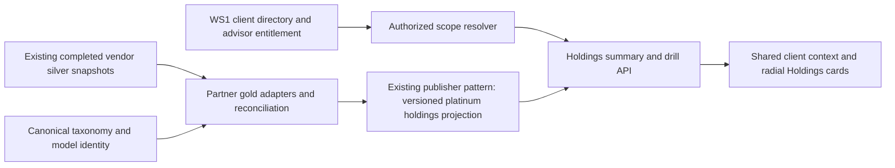

# Investor Reporting WS4 — current holdings and model-overlay design

> **Organization update, September 10, 2026:** Andrew has replaced the former project/workstream structure with two projects: [IR FE](investor-reporting-ir-fe-brief-20260910.md) for the complete client-facing product and [IR BK](investor-reporting-ir-bk-brief-20260910.md) for ingestion, tenant scoping, transformations and operations. Both briefs map all four source briefs and five supporting documents. The body below remains dated research; its former ownership labels are historical. Permanent FWD IDs are unchanged. Macro IRPT, directive D9, laptop execution.

Research companion to the [child brief](investor-reporting-model-overlay-brief-20260910.md). These are proposed shapes and adapter rules, not deployed endpoints. Source facts are bounded by the [evidence manifest](sources/INVESTOR_REPORTING_MODEL_OVERLAY_EVIDENCE_20260910.json); examples contain no client data.

## 1. Product shape and scope

Keep the shared header and **Reporting → Analysis → Holdings** tabs. Advisor/firm identity is the authorization and query root; the selected client/relationship/account supplies the viewing scope. Proposed default: the client already selected in the header. If Andrew prefers the advisor's whole book as the opening view, the same backend aggregates the explicitly selected, authorized unique account set and offers client/account drilldowns. It must not silently switch from one selected client to the whole book on tab navigation.

The page starts with holdings value, unique account count, model coverage and source dates. The main cards show a model-led allocation breakdown and its taxonomy drill. A compact table supplies names, amounts, percent of parent, percent of total, value basis and exceptions. Reuse existing panel, selection, typography and color components. This is primarily backend work; no parallel chart design system is warranted.

V1 is **current snapshot only**. Retain source revisions and snapshot lineage for reproducibility. Do not add a history slider, model-membership reconstruction, return chart, drift feed or rebalance recommendations.

## 2. Common data shape: separate custody facts from attribution

The normalizer returns one typed contract through three partner adapters. A single table with `account_id, model_id, percent` is insufficient: an assignment, a target weight and a measured sleeve value are different facts.

| Logical relation / grain | Required meaning | Key safeguards |
|---|---|---|
| **ResolvedScope** / one requested view | Versioned WS1 firm/viewer context; scope kind and selected entity; authorized unique account set; entitlement revision; selection fingerprint | Server-derived; no browser-supplied advisor grant; retain terminated status independently from access |
| **SourceSnapshot** / source object | Provider/tenant, table, object key and version/hash, business date, source value time, observed time, schema and completion state | Record assignment and definition dates separately; latest object timestamp is not necessarily valuation time |
| **HoldingPosition** / unique custody account-position at a snapshot | Namespaced account/security identifiers; quantity, signed market value, currency, cash/accrual and source classification fields; valuation availability | Establish vendor-specific grain before summing; preserve relationship membership separately; null is not zero |
| **AccountModelAssignment** / account-allocation-model relationship | Native account, allocation and model IDs; assignment basis/date; status; managed/excluded/sleeve membership where evidenced | Parent portfolio and child accounts are not additive; native IDs need provider namespaces |
| **ModelDefinition** / versioned parent-child edge or security leaf | Canonical member key; vendor model ID; edge weight and unit; relative/absolute interpretation; security identity and definition date | Recursive multiplication once; detect cycles, missing children and ambiguous IDs; retain unmatched mass |
| **ModelAttribution** / account-model-basis at a snapshot | Observed allocation amount, assigned amount and target weight as distinct nullable fields; attribution basis; evidence links; reconciliation state | Never coalesce an inferred target amount into an observed sleeve value |
| **PositionAttribution** / custody position-allocation relationship, only where evidenced | Canonical security match, allocation position and measured amount/quantity with dates | Same ticker in multiple sleeves is not an ownership join; target membership alone cannot populate this relation |
| **DisplayNode** / scope-snapshot-taxonomy node | Registered category/member, parent, amount basis, available value, total/parent denominators, account count and coverage | Account counts recomputed as distinct sets at each node; nodes carry source and availability metadata |

Proposed `value_basis` vocabulary: `custody_observed`, `allocation_observed`, `account_assigned`, `target_attributed`, `unresolved`. Store money with decimal precision, currency and valuation convention; target weights are fractions with explicit units. A mixed-basis summary must explain its components and use an assignment label. It cannot be titled “actual sleeve holdings.” An observed-only view must show its uncovered remainder.

The custody total remains the control total. Allocation valuation, target attribution and model-headline AUM are separate measures reconciled to that control where meaningful; they are not additional assets to add to it. Select a common valuation currency/basis or show separate currency totals until an evidenced conversion is available. Price, unsettled quantity, cash, fees and accrued amounts cannot be assumed interchangeable across vendors.

## 3. 49 Financial: Schwab 08335338 + SmartX

### 3.1 Exact current inputs and joins

All paths in this subsection are under `s3://opal-data-assets/`.

| Input prefix | Selected partition | Rows | Use |
|---|---|---:|---|
| `schwab/08335338/silver/fact_acc/` | 2026-09-09 | 7,442 | Custody account universe and source identity |
| `schwab/08335338/silver/fact_rps/` | 2026-09-09 | 104,807 | Complete custody positions; value/quantity basis |
| `schwab/08335338/silver/dim_position/` | 2026-09-09 | 104,807 | Narrower parallel representation; not additive to fact_rps |
| `smartx/platform/silver/fact_allocation_account_map/` | 2026-09-10 | 7,453 | Allocation → SmartX account → custody account number |
| `smartx/platform/silver/fact_model_allocation_roster/` | 2026-09-10 | 9,980 | Allocation/model identity, roster value/status and source advisor fields |
| `smartx/platform/silver/fact_allocation_positions/` | 2026-09-10 | 119,644 | Observed allocation security positions |
| `smartx/platform/silver/fact_allocation_valuation/` | 2026-09-10 | 9,980 | Equity, long/short equity, cash, accrued items and counts |
| `smartx/platform/silver/fact_account_allocations/` | 2026-09-10 | 0 | Empty in this cut; cannot be the only assignment source |

`fact_rps.account_id` joins `fact_acc.account_id`. Its value field is `market_value_settled_unsettled`, with `quantity_settled_unsettled`, business date and instrument identifiers retained. Confirm the source's economic position grain, including any long/short or accounting splits; a symbol-only collapse is not valid.

`fact_allocation_account_map.allocation_id` joins the roster, allocation positions and allocation valuation. The map's `account_id` is a SmartX identifier, **not** the Schwab account key. Validate `account_number` against its declared eight-digit grammar, then left-pad to ten digits to join Schwab `account_id`. Never apply generic numeric coercion to custody account-number strings.

Measured: 7,434 map rows satisfy that grammar; 7,431 join the custody account table. Nineteen have invalid grammar and three valid numbers do not match that inspected universe. The joined rows cover 5,856 distinct custody accounts. All 7,453 map allocations have roster identity; the roster has no duplicate allocation ID in this snapshot. Of the 7,431 joined allocations, all have valuation rows and 7,402 have position rows, totaling 113,289 matching allocation-position rows. The remaining 29 are **not** automatically empty; cash or another source condition needs reconciliation.

### 3.2 Attribution and reuse

Reuse the account-number grammar, join statuses and account/model grain from `b04_account_model_membership.py`. Its roster-value aggregation is useful precedent; measure how roster `value`, valuation `equity`, positions, cash and accrual reconcile before choosing the observed allocation numerator. Do not sum all of these measures together. Allocation `market_value`/`value`, quantity, symbol IDs and account mapping can support observed model drilldowns, but security aliases and valuation dates still need certification against custody positions.

SmartX `as_of` in the inspected positions/valuations runs approximately **September 10 13:06–13:08 UTC**, while custody business date is September 9. A valid join is not proof that these amounts reconcile as a same-time snapshot. Carry both clocks; select compatible completed sources or visibly qualify the overlay.

The older runner hardcodes advisor-level unavailability. Its legacy group/account source at `opal-data-49financial/gold/advi/dimensions/bridge_group_account/` has only an August 18 dated partition in this census: 29,907 rows, no populated `is_primary`. The related group dimension has 201 rows at that date. Do not treat overlapping groups as a partition or use arbitrary keep-first membership as advisor credit. A visibility query may still use the unique union of accounts authorized by WS1 without assigning primary economic credit to one advisor. Any whole-firm sum across advisor books needs a separate non-overlapping attribution rule.

The `08242234` silver root was listed as metadata only. Its holdings were not read and are outside this 08335338 pilot. Existing Tax/SMA members from another master are not imported merely because they share a display taxonomy.

## 4. Inflection: Orion + Eclipse

### 4.1 Exact inputs and catalog behavior

The following selected partitions are all **September 10** under `opal-data-assets`.

| Input prefix | Rows | Principal fields |
|---|---:|---|
| `orion/inflection/silver/fact_positions/` | 35,974 | `id`, `accountId`, `registrationId`, `clientId`, `productId`, `currentShares`, `currentValue`, `assetLevelStrategyId`, `modelName`, `asOfDate` |
| `orion/inflection/silver/fact_assets/` | 35,974 | Parallel source; use for declared enrichment only, not a second holdings sum |
| `eclipse/inflection/silver/fact_portfolios_simple/` | 845 | `id`, `accountId`, `modelId`, account fields, tags, sleeve/deletion flags |
| `eclipse/inflection/silver/fact_portfolios_full/` | 858 | Portfolio `id`, `modelId`, `model`, `managedValue`, `excludedValue`, `totalValue`, `numOfAssociatedAccounts`, cash/settings |
| `eclipse/inflection/silver/fact_models/` | 18 | Model catalog identity/name |
| `eclipse/inflection/silver/fact_model_composition/` | 9 | Catalog identity/name and JSON-string `modelDetail` tree |

Select positions as the custody valuation base. The assets feed equals it on `[id, accountId, productId, currentValue, currentShares]` in this cut; this does not certify equality of every field. Position ID is unique here.

Join simple `accountId` to Orion `accountId`. All 790 non-null simple account IDs match; 55 simple rows have no account ID. Resolve declared integral model IDs consistently: a nullable numeric column can serialize an integer as `3.0`, whereas another catalog uses `3`. Canonicalize these declared IDs with an integer grammar; do not use broad floating-point conversion for identifiers.

Build a namespaced model catalog from **both** models and composition. Of 663 populated simple `modelId` assignments, 256 resolve in models, 567 in composition, and 658 in their union. The two catalogs have one overlapping ID and no name conflict on it in this snapshot; their union has 26 IDs. Five populated assignments remain unresolved. A name/catalog lookup and a complete target-definition lookup are separate coverage measures.

`modelDetail` is a JSON string carrying nested `children`, `targetPercent`, node identity/type and security-asset identity. The inspected full portfolio's `model` is a name string, not that graph. The current detail tree establishes structure, **not a verified percent-unit convention for every node**; pin units and parent sums from fixtures before using it economically.

### 4.2 Account assignment is not portfolio headline value

Join full and simple by portfolio `id` for enrichment. The 13 full rows absent from simple are multi-account portfolios; total portfolio value cannot be copied to each child. Obtain their explicit account/sleeve membership from a source contract or retain them as unresolved. Do not infer membership from a friendly name or distribute headline value proportionally without evidence.

For a proven single-account assignment, account custody value can support a clearly labeled assigned-model view. If Eclipse exposes a managed subset or exclusions, preserve that boundary and reconcile it to custody rather than assigning all account assets by default. Account holdings remain actual account holdings; a model definition supplies targets, not proof of which sleeve owns a particular security. Orion asset-level strategy fields may provide finer evidence but require a certified strategy-to-model bridge before use.

`INF_E_00.eclipse_model_portfolios.py` already distinguishes model-headline AUM from decomposable account AUM. Reuse that distinction and its identity join intent. Adapt legacy snake_case columns to the actual camelCase monolithic sources; do not reuse a historic fixed Opal-model allowlist as the universe of all selected-client assets.

### 4.3 Advisor/household substrate is partly in the legacy bucket

At `opal-data-inf/silver/api_dims/`, September 10 `accounts_v2` contains 874 unique accounts, each with `rep_id` and `household_id`; there are five representative IDs and 293 households among these rows. The 19-row `representatives` roster contains all those account representatives. All 874 accounts join the 953-account holdings universe; 79 holding accounts are not in the inspected account dimension. None of its account IDs lack holdings in this cut.

`runners_inf/a00_dim_account.py` derives universe membership by current `rep_id IN representatives roster`, preserving declared exclusions rather than copying a fixed allowlist. This is useful firm-population evidence; it does not prove that a logged-in portal advisor is that representative. WS1 must supply the authenticated binding, resolve unexplained holdings accounts and distinguish universe eligibility from authorization and termination visibility.

## 5. Cottonwood: Black Diamond + Rebalancer

### 5.1 Holdings grain and assignment bridge

Under `opal-data-assets/blackdiamond/cottonwood/silver/`, `fact_holdings` is dated **September 9**: 18,917 rows, 969 accounts, 18,817 unique `(AccountID, AssetID)` keys. The 100 duplicated keys have equal `Market Value` within each group. Preserve `RelationshipID`/membership separately; compare relevant value, units and date fields before collapsing to one economic position. Conflicting duplicates are exceptions, not keep-first fixes.

`build_dim_model_portfolio.py::collapse_relationship_grain` already asserts agreement of market value, including null/value disagreement, before collapse. Its account aggregation carries `has_value` so an all-null account is not advertised as a true zero. Reuse this control and extend the drill contract to cover quantity/date equality and partially missing valuations. A partial sum must retain its missing-value coverage, not merely pass because one amount is non-null.

The newest observed Rebalancer partitions are **August 30**:

| Table | Rows | Join role |
|---|---:|---|
| `fact_model_assignment` | 950 | `external_id` → holdings `AccountID`; named strategy → roster |
| `fact_model_roster` | 65 | Native model identity and unique name; 23 rows marked Opal |
| `fact_model_blend` | 118 | Parent/child identity, relative and absolute allocations, depth |
| `fact_model_definition` | 1,595 | Model security leaves and definitions |

Assignment `external_id` is the holdings identifier; numeric Rebalancer `account_id` and account-number fields are different keys. Of 950 assignment rows, 946 match holding accounts; 23 of the 969 holding accounts have no assignment. All 464 nonblank/non-`--` strategy names have a unique roster-name match after whitespace normalization. Record this as a fallback name bridge with source date and ambiguity checks. Prefer native model IDs if a producer can supply them; do not add fuzzy name matching.

Closed/excluded/managed/sleeve flags remain in complete silver. The gold policy interprets them; it must not silently convert closed status into revocation or remove an entitled terminated client from the directory. Assignment absence, an explicit unassigned strategy and a failed name bridge are different states.

### 5.2 Target-based attribution and recursive composition

The existing economic calculation is:

`assigned leaf amount = unique account holdings value × product of relative target weights along the path`

This is **assigned model mix / target-based attribution**, not measured executed sleeve value. In a synthetic account worth 100 units assigned to a 70/30 blend, the attributed amounts are 70 and 30; they do not prove that observed securities in those sleeves are worth those amounts. An observed-allocation mode requires additional evidence and retains missing coverage until then.

The measured blend weights are fractions between 0.015 and 1.0; all 118 rows are first-depth edges in this snapshot. The reusable decomposition supports recursion. Use either relative path multiplication or already-absolute weights according to the declared source contract; never multiply an absolute weight again. Repeated leaf paths accumulate amounts; recursion detects cycles and missing weights/nodes and reports unresolved mass. The old helper can return an empty branch for a cycle/missing case; that behavior must not silently make assets disappear in this view.

Preserve the existing parent-or-leaf Opal logic: a non-Opal wrapper may contain an Opal leaf, and an Opal parent may contain other constituents. Filtering a wrapper first loses legitimate attribution. Do not renormalize surviving Opal children to 100%; preserve the remainder. Model-target constituents and account-held securities are separate drill destinations unless observed position attribution exists.

The newer Cottonwood pair builder carries a Cottonwood DIVZ SMA under a shared canonical member key despite different vendor IDs. Older “SMA only on 49F” prose is historical. The live August 30 Rebalancer schemas also lack newer source-side timestamp fields declared in current repository schemas; do not invent their values. Carry object/source dates and flag schema parity when those fields are needed.

## 6. Taxonomy, percentages and radial presentation

### 6.1 Reuse the registry, not a label heuristic

The shared registry's stored categories are `models`, `strategy`, `alternative`, `insurance`, `client`. Its display mapping places strategies under **SMAs**, and Models under **Primary / Custom**. Reuse registered model/member identities and drill children. Client has alternative **Opal Supervised / Unsupervised** (fee-taking) and **Advised / Residual** (advisory) views. Draw one chosen partition at a time; their four labels are not four additive buckets. The existing default Client display axis is fee-taking.

Opal fee-taking/supervision needs its current source predicate. A vendor `AccountSupervised`, an advisor tag or a model name does not substitute for it. A missing classifier is `classification_unavailable`, not Unsupervised and not known Client. Unknown member identity remains a declared mapping exception. Intentionally unassigned assets can be classified as Client only when the authoritative business rule establishes that classification.

Start visible cards with Models, SMAs and Client; include other applicable categories rather than dropping their value. The registry's existing MDPF view-plane Insurance exclusion is not automatically a Holdings exclusion. Preserve selected custody assets and show any policy exclusion explicitly with its denominator effect. Do not import firm-level totals, other custody masters or category members as invented client holdings.

### 6.2 Percentages and signed values

At the top level, percent of total is `node amount / declared scope holdings denominator`. Within a drill, show percent of parent as `node amount / parent amount`, alongside percent of total when useful. For a synthetic total of 100 with Models 70, SMAs 20 and a classified remainder 10, the three shares are 70%, 20%, 10%. A 14-unit model is 20% of Models and 14% of total. These are explanatory arithmetic examples, not product thresholds.

Only combine nodes sharing a coherent attribution basis and complete accounting partition. If SmartX observed allocations and custody differ, show the reconciliation difference and dates; do not squeeze the slices to fit or call the unexplained amount Client. Coverage is separately measured over accounts, valued holdings and model definitions. Denominators identify whether missing-value accounts were excluded from an available-value sum.

A donut requires nonnegative components and a positive declared denominator. Net negative positions, shorts, zero totals, unknown valuations and mixed currencies need an explicit alternative: retain the signed table/summary, and show a clearly labeled long/gross composition only when its denominator is deliberately defined. Never use `Math.abs` on net holdings to produce an apparently complete allocation pie. A neutral unavailable state is preferable to a fabricated 100% ring.

### 6.3 Component reuse

Use `CategoryViewTree.tsx` for declared tree semantics, availability and canonical model colors, and existing Advisor Intelligence donut/drill components for radial interaction. The current commission's pie/radial choice governs this tab even where the older category view used bars. Reuse `getModelColor(getCanonicalModelName(...))` rather than creating a second palette.

Provide a center value/scope label, legend, breadcrumbs and table equivalent. Clicking a category changes the next card/level in the same snapshot; clicking a model reveals its evidenced attribution and accounts. Large category sets can collapse into an explicitly enumerated Other display group without changing their underlying financial classification. Model and account counts are not summed blindly across overlapping nodes.

## 7. Movement and fast serving

This is a data-flow proposal, not an implementation sequence or cloud deployment request.



Prefer a bounded snapshot normalizer using the established runner/Lambda packaging where measured runtime fits. Produce reusable account-level facts and small model/category aggregates after source completion; the publisher owns stored serving JSON. At request time, resolve current permitted accounts and aggregate/filter those precomputed facts for the selected client or advisor book. Client search reads the shared small directory and triggers no SmartX/Eclipse/Rebalancer refresh.

Resolve sources from completion and business-date contracts, not `sorted(keys)[-1]`. An empty expected source must be distinguished from an incomplete pull and a real no-data partition; prior trading-calendar/source-selection logic is useful. Carry all selected source objects in a manifest and promote summary/drill together only after consistency checks. A source failure may leave the last coherent model revision visibly stale while a newer independent holdings snapshot remains available with explicit dates.

Cache identity includes firm, resolved scope/account-set fingerprint, source snapshot set, taxonomy/transform version and relevant authorization revision. Reauthorize every read, including warm cache hits and drills; an old revision cannot defeat revocation. A delayed response must match the current selection fingerprint. Group/advisor aggregates use unique account sets, not sums of precomputed overlapping relationship totals.

Choose the materialization grain and runtime after measuring account/position payloads, representative whole-book requests and drill depth. The raw 23-object evidence set is approximately 15.8 MB, but that is **not** a benchmark of API size, Lambda memory, cold-start time or full-estate cost. No hard TTL, latency SLA, monetary tolerance or refresh delay is invented by this brief.

## 8. Validation and remaining dependencies

| Concern | Meaningful proof needed for implementation | What this research established |
|---|---|---|
| Advisor scope | Current login bindings, expected account sets, overlap/termination/revocation fixtures across partners | Legacy identity coverage counts and existing predicate code; no live permission test |
| Unique custody control total | Vendor grain, duplicate agreement, cash/accrual/currency/null treatment | COT duplicate-key/value counts; Orion parallel-feed equivalence on five fields |
| Observed SmartX attribution | Allocation equity/positions/cash reconciliation to custody at declared compatible clocks; security aliases | Map/roster/valuation/position key counts and source dates |
| Eclipse assignment | Complete catalog and tree coverage, multi-account membership, managed/excluded values and ID units | Combined catalog improves assignment resolution to 658/663; 13 multi-account full-only portfolios |
| Cottonwood target mix | Current assignment/definition source, exact recursive weight semantics, unique name bridge and residual conservation | August 30 lag, named assignments resolve, existing target multiplication and fraction-valued edges |
| Taxonomy | Current registry member mapping and per-account Client predicates, relevant categories preserved | Registry/display structure and prior-art semantics; no live full classification census |
| UI/serving | Same-revision summary/drill, accessible radial/table behavior, payload/runtime and error-state exercises | Existing component code only; no portal run or performance test |

The compiler's scoped source graph did not catalog `b04_account_model_membership.py` despite its checked-in presence. `comp-freshness chain bd` declined its held configuration; that configuration was not read or overridden. These are tooling limits, not reasons to infer missing source code or a healthy/unhealthy pipeline. The direct S3 census supplies the specific source observations above.

## 9. Evidence and reproduction

`docs/research/investor_reporting_model_overlay_20260910/profile_snapshot.py` is an **offline** profiler. It reads explicitly supplied private snapshot metadata/Parquet paths, verifies all raw SHA-256/byte counts, performs the structural joins, and emits schema/count/source fingerprints without client rows or local raw paths. It makes no network calls and does not transform production data.

The collection selected the latest dated partition on or before September 10 independently for 19 named monolithic silver datasets, bounded each downloaded object to 32 MB, and inspected four code-declared legacy identity prefixes. Six silver roots were listed; the second Schwab master was metadata-only. This is a scoped census, not a search of every bucket or a claim of all-source completeness.

```powershell
python docs/research/investor_reporting_model_overlay_20260910/profile_snapshot.py `
  --snapshot-profile <private-latest-snapshot-profile.json> `
  --identity-profile <private-identity-profile.json> `
  --prefix-census <private-prefix-census.json> `
  --source-list docs/research/investor_reporting_model_overlay_20260910/source-list.json `
  --repo-root . `
  --output <sanitized-evidence.json>
```

Private metadata supplies each source object key, byte count, SHA-256 and local Parquet path. The committed evidence retains keys, dates, schemas and aggregate counts; it deliberately omits private row values and raw-file paths. `source-list.json` records the inspected repository paths and read scopes; whole-file hashes do not imply every line was reviewed. The profile's date range and key matches establish neither monetary parity nor authority to serve a particular account.
