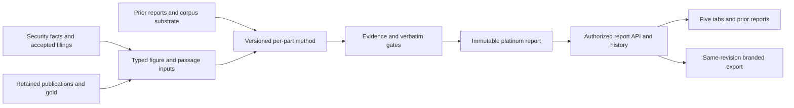

# Analysis, page and export: current path and completion brief

**Proposed closer R, also sole shared API/frontend/deployment integrator.** Authority for the new outcome family: `docs/briefs/amgt-resapp-claude-analysis-layer-brief-20260922.md`, O1..O13 and message design P1..P10; existing RESAPP and CORPUS PRDs retain their own contracts. The analysis brief is an outcome/design source, not evidence that all of its new contracts have been ratified or implemented. R first records that reconciliation, rather than silently treating proposals as existing runtime types.

## The missing chain

The left-hand substrates are partially present. The right-hand report chain has not been demonstrated. The complete current bucket census contains **no platinum objects**. A scoped content search for platinum under `lib/research`, `integrations/bloomberg` and the registry found registry references, not a report producer. A corpus-substrate caller search found only its module/tests. These are bounded absence measurements, not a claim that no uncommitted work exists anywhere on another device or worktree.

## Reuse and complete

| Stage | Reusable substrate | Remaining implementation/proof |
|---|---|---|
| Report inputs | Numeric model blocks, annual filing/passage analysis, publications, five-member corpus substrate | One input manifest by canonical key/hash; required quarterly forms, figures, fund context and comparable inputs; explicit missing sections |
| Method | `lib/research/filings/analyze.py` and sentence/evidence schema; measured team report skeletons | Versioned per-part prompt/schema, stable figure IDs, continuation delta, sector KPIs and fund-form choice; do not turn the writer into a web retriever |
| Synthesis/check | Existing citation/verbatim/check-face logic | Per-part evidence validation, held counts, Posture from accepted parts, uncited/incorrect-number controls, empty/failed run cannot replace a good report |
| Publication | Existing harvest address builders and registry | Ratified report TABLE/schema, canonical platinum JSON address, immutable security/as-of/revision identity, validated current pointer and narrow access |
| Serving | Actual scoped API, existing source-auth pattern, model versions | Authorized report/history/prior-source read; hash-based stale reasons; rerun lifecycle; preserve firm-owned context restrictions |
| Browser | Header, Lead Panel, Thesis/Exec Management/Peers/Model/Posture tabs | Report projection shared across tabs; prose slots on table tabs; machine markers, held counts, lineage and exact revision in every consumer |
| Export | Existing model-block PDF renderer and Print action | Team's report shape and brand, exact displayed accepted revision, figures/table values identical, retained PDF/receipt/hash and reload |
| Other consumers | O11 names MCP/shared workflows | One documented report-read contract and a reproduced consumer read; no second report writer or separate mutable projection. Registration/permission needed for any external consumer remains explicit. |

The existing `/versions` and `/compare` are useful numeric history; they do not implement complete earnings-report history. The current print call takes a security key and loads its model block. It does not freeze the new analysis document displayed across the five tabs. Preserve existing correct identity and fiscal-overlay controls while extending the flow.

## Complete outcome map

| Analysis brief outcome | Gap / required proof |
|---|---|
| O1 standard latest-quarter report | R01, R02; actual retained inputs -> accepted report -> page/export |
| O2 prior recommendation/thesis/KPI delta | C03, R01; each prior assertion cited and reassessed, no-prior case explicit |
| O3 checkable sentences | R01/R02; every served sentence resolves evidence; unsupported sentence held/countable |
| O4 business-type KPI shape | S05, C03, R01; bank/insurer/industrial differences justified by templates and available figures |
| O5 team's prior reports | C02/C03, R02; reachable original plus citable exemplar |
| O6 prose on other tabs | R02; Management, Peers and Model use accepted per-part projection |
| O7 synthesized Posture | R01/R02; cites part sentence/figure IDs, not a new unsupported independent verdict |
| O8 input-hash freshness | R01/R02; move one input and show exact stale part, unchanged parts retained |
| O9 prior/current report versions | R03; immutable revisions and reproducible selection |
| O10 deliberate gated rerun | R01/R03; refuse bad replacement, retain prior good object |
| O11 branded report and other consumers | R03; one projection and same-revision export/consumer read |
| O12 independently versioned method | R01; artifact version stamped, method update without page/producer rewrites |
| O13 every library name | S01/C02/R04; all 93 folders accounted for, then resolved/admitted/reported or an explicit approved scope exception |

## Calls to settle at program start

Record existing authority, or obtain the specific missing decision, for the amended timeline spec; permitted publisher validation/backfill scope; model tier and bounded cost run; Bloomberg-derived figures sent to the model API; and fund form where a name belongs to both funds. These are recorded questions in the source briefs/current project constraints, not new generic approval bureaucracy. Complete schemas, local adapters, offline evidence gates and integration while any external operating decision remains outstanding. Do not claim that a ten-part live cost card or licence determination has been made by this audit.

The voice memo's V2 Teams analyst, proactive flags and earnings-calendar/notifier work is outside this MVP package. Existing FWD social/list outcomes are retained in S06; their notifier tension must be resolved explicitly rather than quietly absorbed into V2 or built despite the moratorium.
