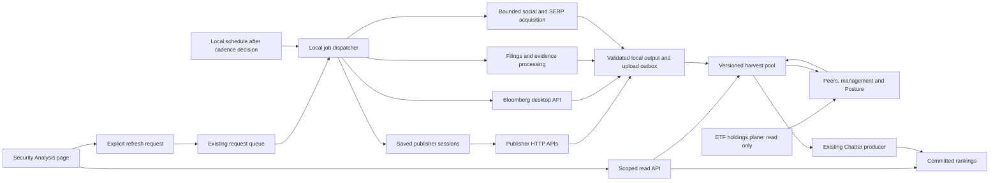

# AMGT_RESAPP v0.8: technical implementation spec for discussion

Author: `4.0.0_SA_CRO~W`. Date: 2026-09-15, review begun 13:57Z.
**Status: engineering proposal for Andrew's discussion.** This document does not amend the signed PRD, issue task orders, or declare the application validated.

## 1. Scope and evidence

Andrew's direct Codex instruction, verbatim:

> I want you to now take a look at this and actually spec out the various technical implementations and lets discuss: (org/missions/D5/AMGT/AMGT_RESAPP/prd/AMGT_RESAPP_PRD.md, v0.8 @1170b4da69

Requirements were read from **`org/missions/D5/AMGT/AMGT_RESAPP/prd/AMGT_RESAPP_PRD.md@1170b4da69d1f37471baff2b2d4d042712e41264`**, including its supersession map. The current decomposition's section 19 and scoped code were read separately. A current workspace head observed during the review was `e5f7d4dd42ea14f038a9a1ac3f32c287fd1ffbe4`; the workspace is shared and work is continuing. No live deployment census or new collector/model calls were made for this specification. Official API documentation was checked read-only.

The intended application has one header and five tabs: **Thesis, Exec Management, Peers, Model, Posture**. Print is a header action. The pool is `s3://opal-data-harvest`. Publisher acquisition and Bloomberg-dependent processing execute on this device. AWS continues to store and serve results. Collection cadence remains Andrew's decision.

### Code already available to build on

| Component | Inspected implementation / evidence | What this establishes |
|---|---|---|
| Five publisher sessions and collection | `lib/opal_data_harvest/`; Barron's retrial report `@9118d18e4f` | Working bounded local acquisition, clean article objects, deduplication and uploads. Two independent Barron's slider trials passed; automatic worker retry acceptance remains separate. |
| Identity and union | `lib/research/identity/crosswalk.py@282d3f769b`; `build_universe.py` | Explicit canonical keys and association aliases exist. This does not mean every input name is resolved. |
| Pool reader and ranking writer | `lib/research/coverage/pool_reader.py@fda8d96c0a`; `metrics/chatter_axis.py` | Shared body/link reading and immutable ranking-generation writer exist in source. |
| Route identity | drain `ac10e06de8`; `lib/research/api/scoped_amgt.py` | Canonical resolution is implemented at the security-route boundary. Deployment is a different state. |
| Filings | `lib/research/filings/`, implementation `8abfd829a7`, partial drain `f8b3475c87` | Two-pass extraction, passage maps, held uncited claims, typed drafting and a disabled batch definition exist. Drain reports five filing trials; those remote objects were not re-fetched here. |
| Peers | `lib/research/peers/`, implementation `ff90cac77d`, drain `9c8071c404` | Candidate loader and ranker exist. Drain reports 33 pool objects and a 5-present/12-absent CSC mapping. The map explicitly distinguishes approximate bases. |
| Bloomberg model / on-demand transport | `integrations/bloomberg/research/model_block_pull.py`, `pull_consumer.py` | Existing raw/derived pipeline and finite SQS consumer should be reused. |

Management, Posture and social acquisition are specified in the current round-11 cut. This review does not assert completion of work still in worker branches. The shared scoped API still has legacy ranking reads and returns 501 for `/refresh` at the inspected version.

## 2. Architecture

The diagram is the proposed completed system. Page reads serve persisted results; an explicit refresh creates a job and reports its progress. Opening a tab does not log in to a publisher or invoke the filings model. The existing cloud Chatter producer can continue as a reader of the pool; the local-placement instruction governs collection, and does not require migrating the portal API or all existing derived-data jobs.

## 3. Identity and the universe

**Reuse:** `crosswalk.py` and its schema. The current cut chooses the measured model-key convention, such as `BA_US_Equity`, as canonical. Resolve it from evidence once; do not manufacture it from an arbitrary ticker.

Each crosswalk entry must retain the canonical key, Bloomberg ID, display ticker, exchange/share class, model key, all historical publication-link aliases, publisher identifiers, filing identity/CIK and source evidence. An unresolved or ambiguous alias returns a reason and candidate identities; it cannot select a convenient US security.

Build a versioned union of the 89-name coverage input and the current four ETF books. Preserve source membership (`coverage`, `holding`, `both`), individual book weights, snapshot date, schema version and unresolved dispositions. Holdings references remain read-only. Deduplicate economic securities while preserving multiple book memberships. Publish the input and output counts.

**Acceptance:** all 89 coverage rows get a disposition; canonical, Bloomberg and legacy association forms for Boeing resolve identically; an ambiguous ticker and two share classes do not collapse; rerunning the mapper creates no additional identity. These are contract checks, not an instruction to mark unresolved names complete.

## 4. Publisher acquisition and gradual backfill

**Reuse:** `lib/opal_data_harvest/{contracts.json,publishers.py,worker.py,storage.py,uploads.py}` and the canonical session harvesters.

| Publisher | Discovery input | Body acquisition |
|---|---|---|
| Seeking Alpha | Resolved symbol through `/api/v3/symbols/{symbol}/news`; add separate analysis discovery to complete the PRD's commentary scope | Existing news JSON body; PRD also names `/articles/{id}` and `/virtual_analysts/{sa_id}` for analysis/report support |
| FT | Company name through `/search?q=...` | Authenticated HTTP with JSON-LD body; HTML extraction only as recorded fallback |
| WSJ | Company name through `/search?query=...` | Authenticated HTTP with embedded Next article JSON |
| Bloomberg | Quoted company name through `/nemo-next/api/search/query` | Native story JSON by resource ID |
| Barron's | Company name through `/search?query=...` | Native `/articles/api/articles/{slug}` JSON |

Search is candidate discovery. A company-name match is not an aboutness decision. Record the query/version, publisher, cursor/window, candidate ID and admission evidence. Measure true company coverage against incidental mentions before promoting the current name-mention check into a substantive relevance rule. SA news, analysis and virtual reports are different products; the current news-only worker is not full implementation of the PRD's SA source contract. Verify the existing report/analysis implementation before wiring it, preserving the already-discharged REST-versus-modal comparison.

**Recovery state machine:** reuse saved bundle -> request -> validate response contract -> persist accepted output. A challenge takes the bounded browser verification path using the saved login; verified logout takes the credential-login path; either successful recovery retries the original operation once. A 429 persists `Retry-After`; repeated rejection defers the job. HTTP 200 with a preview/challenge remains failure. Publisher cooldowns and one-worker locking persist across restarts. For Barron's, complete the worker replay test before removing its experimental guard.

**Proposed scheduler inputs:** `publisher_set`, `universe_version`, `jobs_per_cycle`, `new_bodies_per_job`, `http_requests_per_cycle`, `max_runtime`, `publisher_wait`, `backfill_floor`, `recent_overlap`, `upload_budget`. They are independent caps: two accepted bodies can require more than two HTTP calls. Retain the measured 15–25-second pacing as a starting configuration, not a promise against rate limits. Daily quantities and activation are not selected by this spec.

Maintain **two cursors per security/publisher**: incremental discovery near the present, and backfill toward older dates. Alternate them fairly across the universe, with durable progress and publisher cooldowns. A capped first page must say `window_incomplete`; it must not claim exhausted history. If a publisher has no measured continuation method, backfill for that publisher is limited until one is established. Prioritize obtaining a comparable recent 30-day coverage window before extending far back.

Use `publisher:article_id` for global body identity. Store one body at `publications/v1/{publisher}/{sha256(article_key)}.json` and independent associations at `publication-links/v1/{security_key}/{publisher}/{same_digest}.json`. Repeated links and aliases count once per security. Preserve `published`, `fetched_at` and `first_discovered_at` as three different clocks. A later article correction needs an explicit revalidation/version policy; unconditional refetching is not that policy.

## 5. Shared data contracts and versioning

Use the shared `coverage/pool_reader.py` for feed and Chatter. Validate article/link schemas, key/hash correspondence, body existence and identity aliases. Map `published` to consumer `published_at` only at this boundary. Expose malformed, denied, missing-body and partial reads separately from a successful zero result. Retire the articles-table read/grants after both consumers pass their pool integration tests.

Retain existing PRD and round-11 prefixes:

| Product | Contract location |
|---|---|
| Identity, membership | `crosswalk/v1/{as_of}.json`, `universe/v1/{as_of}.json` |
| Article bodies and links | `publications/v1/`, `publication-links/v1/` |
| Model/raw stages | Existing `raw/`, `derived/model_block/` and fiscal-year-corrected outputs; preserve the measured key grammar |
| Filings | `filings/v1/{security_key}/{accession}.source.json` and `.analysis.json` |
| Drafting | `drafting/v1/{security_key}.json` |
| Peers | `peers/v1/{security_key}/{as_of}.json` |
| Management / benchmark | `management/v1/{security_key}/{as_of}.json`, `management/v1/_pool/{as_of}.json` |
| Posture | `posture/v1/{security_key}/{as_of}.json` |
| Social first measurement | `social/v1/_measurement/{as_of}.json` |

**Proposed addition:** an immutable pack manifest naming exact object keys, S3 version IDs or immutable run IDs, hashes, source vintages and per-stage states. An `as_of` date alone does not distinguish two same-day analyses. Keep the prescribed public paths; version their contents and pin the exact versions in each assembled pack. Print and comparison must reopen the recorded pack, not whatever happens to be latest. Do not add envelope fields to the strict article schema without versioning it; keep orchestration metadata in the manifest/ledger.

## 6. Model data and explicit refresh

Reuse `model_block_pull.stage_pull` then `stage_derive`; persist raw Bloomberg output first. Each figure carries value, unit, scale, sign, currency, fiscal period, source mnemonic/basis and vintage. Join price/fundamentals on fiscal year. Bloomberg definitions stay visibly Bloomberg definitions. Unknown units, wrong identities and failed checks remain marked values, never zero substitutes. Expand the measured unit map across a US industrial, an ADR, a non-US listing and a financial before assuming generality.

**Observed gap:** `scoped_amgt.handler` still returns 501 on `POST /api/scoped/amgt/refresh`. The earlier `pull_consumer.py` reads `opal-research-pull-requests` and exits after a bounded drain. It is not an always-on listener.

**Proposed completion:** connect the scoped action to the existing request-carrier architecture with a versioned message containing `request_id`, canonical key, selected stage, requested source versions and idempotency key. Preserve the old consumer contract or migrate it explicitly; do not send it an incompatible multi-stage message. The local scheduler invokes bounded drains. The request response is 202 with a job ID; the existing status/ledger surface exposes queued, running, succeeded, deferred or failed and the last successful result. A browser request does not connect directly to the Windows host.

Publishers and Bloomberg Terminal need different recovery policies. The terminal consumer currently checks health and records failure without automatic sign-in. Preserve that boundary. A signed-out terminal is visible to the user; publication-cookie recovery does not authorize a terminal login loop. Persist a terminal job outcome before acknowledging the queue. Idempotency must survive a crash between upload and acknowledgement.

## 7. Filings, drafting and the one chart

**Reuse the two-pass analyzer now present.** First persist the original filing, exact submitted excerpt, accession, identity, hashes, parser version and retrieval time. Build stable passage IDs with offsets into that exact source. Pass 1 requests cited findings; pass 2 maps them into typed classes while retaining only resolved evidence IDs. Validate identity, source version and cited text before admitting a claim. A resolvable citation establishes a location, not by itself that the entire generated claim is supported.

The two-pass choice is also consistent with the current Claude API: document citations cannot be combined with strict structured-output format in one request. [Official citation documentation](https://platform.claude.com/docs/en/build-with-claude/citations).

Persist model/prompt versions and usage. Cache by filing content hash plus analyzer/prompt versions; discover new filings on a schedule but analyze only new/changed input or an explicit rerun. Preserve unsupported claims in `held_uncited` with reasons. Quoted spans must match the cited passage after declared normalization. Distinguish exact-quote checking from support checking for paraphrases. Render source passages visibly next to machine-marked sentences, including print.

**Observed chart gap:** `analyze.resolve_driver()` emits `series`, `unit`, `source_passage_id`, `why` and `resolution`. It does not emit numeric points. Finding the series name in a passage is not enough to draw the chart.

**Proposed chart contract:** extend the filings-derived product through a versioned schema with `metric_id`, definition, unit, currency, period basis, selection rationale and `points[{period,value,evidence_ids,source_version}]`. Derive points from filing tables/passages or a separately validated model series of the same definition. The model chooses the topic; deterministic validation checks every plotted number and period. No fabricated points, no assumed historical comparability after a segment restatement. If usable observations are absent, show the chosen thesis driver and why its chart is unavailable. Gate chart readiness on a real series with multiple cited observations, not on a non-null driver string.

Fetch the officer section as well as business, risk and management-discussion sections. Guidance *changes* require a prior filing/version and an explicit comparison; a statement in one filing alone is not a measured change. The public SEC route is the measured implementation; a Bloomberg-delivered filing remains a distinct source validation before production claims about that route.

## 8. Social feeds and SERP

Separate **official company communications**, **wider discussion**, and **web discovery**. Do not describe official-account posts as broad market conversation.

Initial documented acquisition contracts:

- Reddit: `POST /datasets/v3/scrape`, dataset `gd_lvz8ah06191smkebj4`, `type=discover_new`, `discover_by=keyword`, bounded input `keyword`, `date`, `num_of_posts`. [Official keyword discovery contract](https://docs.brightdata.com/api-reference/scrapers/social-media-apis/reddit-posts-discover-by-keyword).
- X: dataset `gd_lwxkxvnf1cynvib9co`, `type=discover_new`, `discover_by=profiles_array`; resolved profile inputs. This is a profile-discovery contract, not a demonstrated cashtag search. [Official profile discovery contract](https://docs.brightdata.com/api-reference/scrapers/social-media-apis/twitter-posts-discover-by-profiles-array).
- SERP: reuse the existing Bright Data caller with an explicit zone and query grammar; searches scoped to a company's validated IR domain support executive/profile discovery. Persist actual destination URLs, the query, time window and retrieval outcome. Search-engine result estimates are not verified unique discussion counts.

For asynchronous completion, persist the returned job/snapshot ID and poll/retrieve that job. A poll never resubmits collection. Schema, latency, cost, date coverage, cap truncation and relevance are measured on one security first, as S13 requires. The current cut delivers that measurement; a continuous feed requires its subsequent implementation.

**Proposed social item schema:** stable `platform:post_id`, canonical URL, posted/fetched timestamps, text, author identifier, observed engagement with its observation time, associated security keys, official-account status, admission rule/version and evidence. Use a separate versioned social product; do not force short posts into the five-publisher/120-word article schema. Never sum cross-platform likes, comments and article counts as if they were the same unit. Present coverage limits in the header feed.

Publisher allowlist and official-account map use the recorded owner `0.5.0_AE_OpalETL~Z`, provenance and review/rot fields. Connect overdue state to the existing assigned-owner workflow; this spec introduces no separate monitoring service.

## 9. Peers and executive management

### Peers

Reuse the candidate database and engine: Scanner universe union model headers; sector, size band 0.2x–5x, country, industry group, then log-cap distance. Preserve one-security grain, classification mapping, input vintage and excluded counts at each rung. Similarity chooses the comparable set; valuation is a later comparison. Missing classification cannot silently become a weak numeric match.

**Observed data gap:** `peers/csc.py` documents only five available mappings of 17, and two of those use trailing and NTM earnings yields under year-labelled P/E columns. Those bases are explicitly non-equivalent. Treat them as alternative labelled measures, not satisfied fiscal-year columns. Obtain actual fiscal-year estimates from the measured Bloomberg model route; leave unavailable values marked. Populate shares, debt, preferred, minority, cash, leverage and five-year growth only from unit-compatible sources. Dynamic fiscal periods replace perpetually hard-coded 2025/2026/2027 labels. Summary rows show the number of valid peers used per column.

The inspected Scanner vintage is 2026-08-06. Display it and establish the existing producer's refresh path before presenting those factors as today's profile.

### Executive management

The filing defines the officer roster and current-role start. Lusha enriches confirmed officers with profile/title only. IR-domain search can provide the public CEO profile. Never substitute employment start for role start or infer tenure from age. Record source passage, date precision, role, confirmation state and enrichment match evidence; forbid email/phone storage.

**Proposed benchmark definition for discussion:** calculate each company's mean tenure over confirmed current officers, then the equal-weight mean of eligible company means across the union universe. Publish confirmed-officer and covered-company denominators and missing counts. This prevents firms with larger rosters dominating the benchmark. Keep partial dates as ranges or explicitly lower-precision values; never invent a January 1 role start.

## 10. Posture

Read holdings at a pinned snapshot and schema version. Unknown membership is not `not held`. Use the same similarity ranker restricted to the opposite membership set. Select the best comparable by that rule before checking pack availability; if its pack is missing, queue that evidence or mark Posture unavailable rather than silently switching to an easier peer.

Pin **both** names' Thesis, Exec Management, Peers and Model products plus their factor-fit inputs. The model receives those packs, their missing-data states, the membership snapshot and the similarity explanation. It returns the PRD's `better | worse | hold | steer_clear` verdict with individually cited reasons and a machine marker. An absent result belongs in a separate state/reason envelope; do not quietly introduce a fifth recommendation meaning. Align that choice with the cut, which currently also lists `absent`.

Validate citation existence, source association and source versions; numerical claims must reconcile to the named pack fields. Missing evidence is not a negative opinion. The two stocks' valuations must share definitions and periods. Store exact input pack hashes and prompt/model versions so the judgment is reproducible. Refresh Posture only when an input changes or a user explicitly requests it.

The page provides accept/reject/defer with a separate firm decision record keyed to the exact Posture version. Human acceptance does not rewrite the machine output. Nothing connects this artifact to an order/trade producer. Choose the held/non-held QA pair early, then generate all four evidence products for both names before testing Posture.

## 11. Chatter and Price rankings

Reuse the committed movement formulas and the 30-day windows; keep four independent products: Trending Price, Breakout Price, Trending Chatter, Breakout Chatter. Trending Chatter is today's observed count; Breakout compares with the prior 29-day baseline under the existing smoothing and absolute-jump rule. Price uses its existing box-side definitions, not raw share-price ranking. Scores and ranks are produced once and served, never recalculated in React.

**Critical acquisition issue:** gradually collecting five bodies for one name and none for another creates unequal observation coverage. Publication timestamps prevent old news from looking new, but do not repair missing observations. Recomputing an old partition after backfill should create a new generation for that old date, not today's spike. Record source set, completed windows, capped windows and unavailable publishers alongside every daily count. Rank comparable observations or explicitly label the product provisional/partial; an uncollected day is not a zero. Changing admission thresholds or mixing a new social source creates a new measurement version. Do not silently change the existing ranking formula to compensate.

**Generation protocol:** stage all rows under `<AXIS>#<date>#<generation_id>`; validate membership/count/hash; publish `_CURRENT` last. A failed run leaves the previous pointer and records the failed attempt. A successful empty Breakout publishes an EMPTY generation. Existing all-zero Trending tie behavior stays intact. Apply one generation resolver to list, point and history reads. Validate row count and payload hash before returning a result, and prevent an older concurrent run from superseding a newer one with a conditional pointer update.

GSI reads are eventually consistent, so a newly visible pointer does not by itself prove every indexed row is visible. Bound retries for an incomplete generation and return explicit unavailability or the labelled previous generation. [AWS read-consistency documentation](https://docs.aws.amazon.com/amazondynamodb/latest/developerguide/HowItWorks.ReadConsistency.html).

**Migration gap remains:** the shared reader still uses bare-date partitions while the new Chatter writer produces generations. Add explicit producer-format/activation metadata and retain legacy PRICE/history reads until their own migration is verified. Do not interpret a missing pointer as either an empty ranking or permission to use legacy rows for an already-migrated axis/date. Producer and reader deployment/rollback must be coordinated.

## 12. API, page, print and stage ledger

Extend `lib/research/api/scoped_amgt.py` and the existing scoped portal client; preserve current endpoints and add explicit model, management, Posture and decision surfaces through a reviewed contract. The feed can continue to use the existing coverage route even though the Coverage tab disappears. Each response carries resolved identity, data state, source vintage, run/generation identity and the exact product version/hash.

The header combines rankings, company description, recent feed and Posture line. Five tabs consume their own persisted products. Use one shared figure/evidence renderer for screen and print. Render passed, failed, provisional and absent states visibly. A missing source does not become an empty successful chart. Keep firm identity in trusted edge context; enforce access at the API as well as navigation, and keep the starred list per firm. Starring triggers no collection.

Cache keys include firm, canonical identity, route parameters and product version. Do not leave successful-looking empty results indefinitely cached across deployment or refresh. Explicit refresh updates the relevant query/ledger state; an old pack remains accessible. The stage ledger records requested/start/finish times, state, input/output hashes and last successful product independently for market data, filings, news, social and web. Re-running one does not touch unrelated timestamps.

Print consumes a pinned pack manifest and includes source/basis, machine markers and failed/provisional values. Compare two pinned manifests to show actual changes. The freshness view derives from stage vintages, not from whichever file was most recently opened or rendered.

## 13. Build order and acceptance

This is dependency guidance for discussion; COO retains the issuance and decomposition ownership.

1. Complete identity dispositions, source contracts and pack/version manifest design.
2. Connect the pool and generation readers, preserving PRICE/history compatibility; prove scoped refresh reaches a bounded local worker.
3. Complete filings' numeric chart series and management roster/tenure; fill the missing peer financial columns.
4. Assemble the header and five tabs from real persisted products, with all absence/refusal states visible.
5. Generate both sides of the chosen Posture pair, then test the judgment and human decision record.
6. Complete the bounded social measurement; decide source admission and acquisition budgets before building a continuous feed.
7. Exercise the whole application through the live edge, including print and version comparison; then decide collection activation separately.

| Outcome group | Required end-to-end evidence |
|---|---|
| FWD-1/2/12 | A covered and an uncovered name; explicit refresh progresses through the local worker; one stage reruns while other vintages remain fixed. |
| FWD-3/10/13 | Challenged figure resolves to source/basis/date; wrong-unit and ambiguous-identity controls visibly refuse. Run population checks as well as item checks. |
| FWD-4/11/14/16 | Admitted publisher and, after measurement, social items; source click-through; capped/error/quiet distinctions; an overdue list reaches its assigned-owner workflow. |
| FWD-5/6/7 | Pinned print, two preserved versions compared, and a stale covered name found from the freshness view. |
| FWD-8/15 | Canonical ranked click, current complete ranking generation, comparable set with real financial columns and source vintages; changed-winner/empty/interrupted-write controls. |
| FWD-9/18 | Machine prose beside exact evidence; unknown-ID and wrong-source refusal; chart points individually traceable to real filing data. |
| FWD-17 | Officer and role-start verified from filings; missing tenure visible; benchmark denominator and weighting explainable. |
| FWD-19 | Held/non-held comparison with both packs complete enough for the declared rule; cited judgment and recorded human acceptance or rejection. |

Mechanical tests and screenshots establish their stated checks. They do not substitute for the PRD's analyst/PM exercises: 18 of 19 outcomes require actual use. User exercise with Adam is arranged through Andrew, not by contacting Adam directly.

## 14. Decisions to discuss first

1. **Collection priority:** obtain comparable recent 30-day coverage across the universe first, then deepen history. Choose the daily job/body/request budgets after measuring discovery completeness; five articles remains a trial target, not a daily quota.
2. **Chatter meaning during backfill:** show observed collected coverage with explicit incompleteness, or prioritize a separate complete discovery-count product before treating it as a full discussion-volume ranking. A metadata-only count product would need its own admission/storage contract; it is not already implemented by the article-body pool.
3. **Filings cadence:** check for new filings regularly and analyze changed filings once, rather than pay to regenerate unchanged annual filings every week. Model/prompt changes remain explicit reanalysis triggers.
4. **Management comparison:** use equal-weight company means with coverage denominators, subject to Andrew's preference.
5. **Posture readiness:** request the best opposite-side comparable's missing evidence and show pending, rather than compare whichever name already happens to have a pack.

The main engineering work is connecting trustworthy products and their version/failure contracts. The new local code is useful progress; it is not yet a single validated daily research pipeline.
