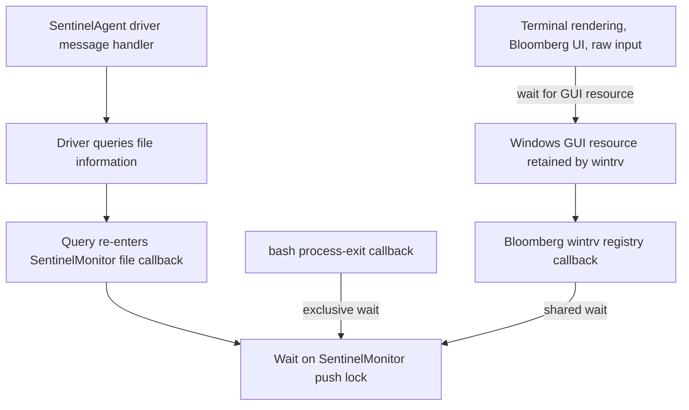

# Local dump findings — site Z, 2026-09-29

Analyst: `4.0.0_SA_CRO~Z`. Microsoft public symbols downloaded with Andrew's
explicit approval. Dumps were neither uploaded nor modified. Installed debugger:
WinDbg package `Microsoft.WinDbg_1.2606.22001.0_x64__8wekyb3d8bbwe`, amd64 cdb,
engine 10.0.29617.1000. Vendor private symbols were unavailable.

## 1. Capture and crash identity

`C:\Windows\MEMORY.DMP` is a readable kernel bitmap dump, 18,686,448,893 bytes.
Debug session time: **2026-09-29 11:34:55.363 ET**. Uptime: **20:51:35.411**.
Bugcheck: **0xE2 MANUALLY_INITIATED_CRASH**, consistent with Andrew's confirmation.
Both keyboard-driver CrashOnCtrlScroll settings were re-read as 1.
`C:\Windows\Minidump\092926-11750-01.dmp` also exists (9,379,372 bytes).

SHA-256:

| Evidence | Hash |
|---|---|
| Kernel dump | `86F17020DD3623EDFCE54E5597CB2AB3028580B9733516EBC19B780A5AD5C5B2` |
| Minidump | `F42E571801AA2AE2F684491C6153335E467F23ADFF5F0E69464291C3C1D82610` |
| Sentinel service dump | `609E36A69925BB87AFC5B81A8836F35BD75BB6EBBCB1296675CC6C466CC1650F` |

The kernel dump's user-space coverage is limited. A stopped stack is evidence
of what that thread was doing, not a complete history of all prior activity.

## 2. Measured lock chain



The outer shared acquisition and re-entry are present in stack/code evidence.
The full ownership cycle is a strong deadlock inference, not a vendor-confirmed
source-level diagnosis. Push-lock metadata does not supply a simple owner list.

### 2.1 Driver-wide bottleneck

`!stacks 2 SentinelMonitor` processed **6,850 threads**. A parser counted **1,070
matching thread records**: 1,069 shared-acquisition paths through
`SentinelMonitor+0x1623cd`, and one exclusive-acquisition path through
`SentinelMonitor+0x161fc5`. File, registry, process creation/exit and thread
creation/exit callbacks are represented. This explains why logging and process
management could stop along with the desktop.

Sampled shared and exclusive stacks identify the **same push lock**:
`fffff8046a47e998` (`SentinelMonitor` global object at `fffff8046a47e990`, offset 8).
The lock has Locked=1, Waiting=1 and Waking=0 at capture. The pointer bits in the
union are not a meaningful shared-owner count when a wait-block pointer is stored.

### 2.2 Reentrant SentinelAgent thread

Thread `ffff968e668e1080`, process `SentinelAgent.exe`, CID `b324.7090`:

```text
User NtDeviceIoControlFile
  FLTMGR!FltpFilterMessage
  SentinelMonitor+0x18592d ... +0x1a4f3f
  SentinelMonitor+0x1a4df9 ... +0x1a40a2
  nt!FsRtlQueryInformationFile
  FLTMGR!FltpPerformPreCallbacksWorker
  SentinelMonitor+0x17e638
  SentinelMonitor+0x1623cd
  FLTMGR!FltAcquirePushLockSharedEx
  nt!ExfAcquirePushLockSharedEx -> wait
```

Wait: **47m32.078s**, beginning approximately **10:47:23.285 ET**.

Relevant instructions before outer return address `SentinelMonitor+0x1a4df9`:

```text
6a4f4dda  lea rcx,[rax+8]
6a4f4de7  call FLTMGR!FltAcquirePushLockSharedEx
6a4f4df4  call SentinelMonitor+0x1a4970
```

The corresponding outer routine later calls `FltReleasePushLockEx` at `6a4f4efb`.
The nested file query has not returned to that release. The nested acquisition
uses the same global object's offset-8 lock in the sampled stack. This is strong
evidence for a recursive shared-acquisition problem with an exclusive waiter.
Private symbols/source or vendor review should confirm the exact ownership logic
and identify the triggering workload; do not infer that bash or Bloomberg is the
defective component merely because its callback participates.

### 2.3 Exclusive waiter

Thread `ffff968e777f5080`, process `bash.exe`, CID `0df4.8d74`:

```text
nt!PspExitProcess -> nt!PspCallProcessNotifyRoutines
SentinelMonitor+0x1a19a5 -> +0x1a093c -> +0x161fc5
FLTMGR!FltAcquirePushLockExclusiveEx -> wait on fffff8046a47e998
```

Wait also **47m32.078s**. This is a waiter, not an identified exclusive owner.

### 2.4 Propagation into the desktop

Thread `ffff968d949d9080`, `wintrv.exe`, CID `7e74.a784`, has waited
**47m31.593s** (approximately **10:47:23.770 ET**) in:

```text
win32kbase!NtUserEnumDisplayDevices
  win32kbase!DrvGetRegistryHandleFromDeviceMap
  nt!NtQueryValueKey -> nt!CmpCallCallBacksEx
  SentinelMonitor+0x1cbe6f ... +0x1623cd
  FLTMGR!FltAcquirePushLockSharedEx -> same push lock
```

`!locks` lists this thread among shared holders of GUI resource
`ffff968d3293c090`. That resource has 57,850,015 recorded contentions, six shared
waiters and 96 exclusive waiters. Other entries include recursive shared attempts;
do not interpret every listed shared holder as a separate independent cause.

Five sampled WindowsTerminal rendering threads wait there for about
44m28–44m31s in `win32kbase!UserEnterUserCritSecShared`, called from
`dxgkrnl!NotifyPendingFlipPresent`. An `ipf_helper.exe` thread waits in a GUI query;
a `bplus64.exe` thread waits 37m31.875s in `NtUserGetMessage`; the csrss raw-input
thread waits for exclusive GUI access. These are consequences of the lock chain,
not evidence that the graphics driver independently failed.

## 3. Earlier Sentinel service crash

File:
`C:\ProgramData\Sentinel\CrashDumps\af142cfc-4bb5-41be-a882-bce2839e6941.dmp`.
Debug-session time: **08:28:53 ET**; file last write **08:32:00**.
6,871,313,492 bytes logical, 5,026,684,928 bytes allocated.

`!analyze -v` identifies `SentinelAgent.exe`, version **26.1.2.177**, custom
exception **0x01042021**, raised from `SentinelAgentCore.dll` (module offset
`+0x13e89bc`). The application-fault bucket agrees. Export-only symbol names with
large offsets are not reliable internal function names. The exception has no
decoded standard status text; it must not be relabeled out-of-memory without
vendor evidence. System 7031 at 08:32:01 records Sentinel Agent service termination
and a configured restart after 20 seconds.

This crash and its disk allocation precede the later ENOSPC failures. They are
important incident evidence but do not alone prove a common cause with the hang.

## 4. Memory and process snapshot

`!vm` at capture:

| Metric | KiB | Interpretation |
|---|---:|---|
| Physical memory | 66,538,236 | About 63.46 GiB |
| Available physical | 32,981,024 | About 31.45 GiB; not exhausted at capture |
| Committed / limit | 55,955,648 / 73,325,908 | About 53.36 / 69.93 GiB |
| Paged pool | 11,590,332 | About 11.05 GiB |
| Nonpaged pool commit | 5,838,032 | About 5.57 GiB |
| Pagefile size / free | 6,787,672 / 3,622,096 | Pagefile larger than its post-reboot 4 GiB allocation |
| Failed commit requests | 171 requests | Cumulative during the boot; not timestamped |

The Virtual Store Paging File line is not an additional on-disk file to reclaim.
Some `!vm` pool-stat reads reported unavailable data; `!poolused` separately
returned tag tables. Large tags include Toke 2,293,240,448 paged bytes, FMfn
902,235,840, SeAt 894,203,072, and EtwB 1,258,909,952 nonpaged bytes.
No time series or allocation stacks identify who caused their growth.

`!process 0 0` enumerated 798 processes, including 120 osqueryi, 78 bash, 75
conhost, 52 bplus64, 43 python, 31 node and 17 powershell. Processes stalled during
exit can remain visible; these counts alone do not prove a spawning storm or a
leak. No claim is made that the historical Huntress/Rio incident was recurring.

## 5. Reproduction and local evidence

From an authorized elevated shell, the installed cdb reads the preserved dump
using `-sins -nosqm -noshell`, an explicit Microsoft symbol path, `-z` for the dump
and `-cf` for a newline-delimited command file. No debugger extensions were
downloaded or vendor server contacted intentionally. Commands used:

```text
!analyze -v
!vm 1
!process 0 0
!locks
!thread ffff968d949d9080
!thread ffff968e668e1080
!thread ffff968e777f5080
!stacks 2 SentinelMonitor
lmvm SentinelMonitor
!fltkd.filters
!poolused 2
!poolused 4
dq fffff8046a47e998 L2
dt nt!_EX_PUSH_LOCK fffff8046a47e998
ub SentinelMonitor+0x1a4df9 L30
ub SentinelMonitor+0x1a4f3f L30
```

Local output files: `dump-analysis-elevated-v2.txt`, `dump-followup.txt`,
`dump-driver.txt`, `dump-lock.txt`, `dump-reentry.txt`, `sentinel-user.txt`, and
the SHA-256 JSONs under `.runtime/crash-investigation-20260929/`. Raw outputs stay
local; this document retains selected technical findings only. The first debugger
attempt was stopped by this investigator after malformed command parsing; no
unrelated process was stopped. Later debugger processes exited normally.
